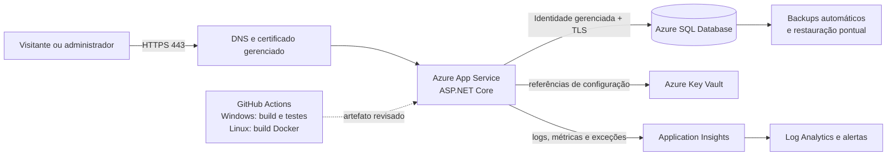

# Plano de nuvem e DevOps — Galeria Aurora

## Estado desta entrega

**Infraestrutura planejada:** os serviços, configurações e fluxos abaixo formam uma proposta para revisão do PIM IV.

**Infraestrutura implantada:** nenhuma. Esta entrega não cria assinaturas, recursos Azure, DNS, certificados, bancos, registros de imagem ou credenciais. O fluxo de integração contínua compila e testa; ele não publica nem implanta a aplicação.

## Arquitetura proposta



### Responsabilidades e justificativas

| Serviço | Responsabilidade | Justificativa |
|---|---|---|
| Azure App Service | Hospedar a aplicação ASP.NET Core, terminar HTTPS e aplicar escala vertical ou horizontal. | Serviço gerenciado, simples para o PIM, sem necessidade de administrar Kubernetes ou máquinas virtuais. |
| Azure SQL Database | Armazenar usuários, catálogo, reservas, pedidos e auditoria. | Compatível com EF Core e SQL Server, incluindo procedures e trigger existentes; oferece backup e alta disponibilidade gerenciados. |
| Identidade gerenciada | Autenticar o App Service no Azure SQL e no Key Vault. | Evita usuário e senha do banco nos arquivos ou no repositório. |
| Azure Key Vault | Guardar segredos que não puderem ser substituídos por identidade gerenciada. | Centraliza rotação, autorização e auditoria de segredos. Para o primeiro protótipo, referências do Key Vault podem ser usadas nas configurações do App Service. |
| Application Insights e Log Analytics | Reunir requisições, exceções, dependências, métricas e alertas. | Integração natural com ASP.NET Core e App Service, adequada para uma equipe pequena. |
| GitHub Actions | Restaurar, compilar, testar e validar o Dockerfile. | Mantém a revisão automática junto ao código sem realizar implantação. |

O Dockerfile permite execução em contêiner, mas a implantação inicial mais simples pode usar a publicação nativa do App Service. Caso a equipe opte por App Service for Containers, deve acrescentar posteriormente um registro privado de imagens e autenticação gerenciada; isso não faz parte desta entrega.

## Implantação planejada

1. Criar um grupo de recursos separado por ambiente, começando por homologação.
2. Criar Azure SQL Database vazio e aplicar as migrations ou o script SQL revisado antes de iniciar a aplicação.
3. Criar App Service para Linux com runtime .NET 10 ou contêiner baseado no Dockerfile.
4. Habilitar identidade gerenciada no App Service e conceder somente as permissões necessárias no Azure SQL e no Key Vault.
5. Definir configurações de produção no App Service, nunca no repositório.
6. Configurar domínio, HTTPS, monitoramento, backup e um teste de restauração.
7. Fazer uma validação manual em homologação antes de qualquer promoção para produção.

Não há etapa automática de implantação na pipeline atual. A promoção deve continuar manual até a equipe revisar ambiente, custos, permissões e estratégia de migração.

## HTTPS e rede

- Usar somente HTTPS público. Redirecionamento HTTPS e HSTS já existem na aplicação fora de desenvolvimento.
- Associar o domínio ao App Service e usar certificado gerenciado. Desabilitar TLS 1.0 e 1.1 e exigir TLS 1.2 ou superior.
- Definir `ASPNETCORE_FORWARDEDHEADERS_ENABLED=true` no App Service para que a aplicação reconheça corretamente o protocolo original atrás do proxy reverso.
- Restringir o firewall do Azure SQL. Para uma primeira implantação simples, permitir apenas os endereços de saída do App Service; para uma evolução mais protegida, usar integração de rede virtual e endpoint privado.
- Não habilitar `TrustServerCertificate=True` em produção.

## Configuração e segredos

Configurações mínimas esperadas no App Service:

```text
ASPNETCORE_ENVIRONMENT=Production
ASPNETCORE_FORWARDEDHEADERS_ENABLED=true
DatabaseProvider=SqlServer
ConnectionStrings__DefaultConnection=Server=tcp:<servidor>.database.windows.net,1433;Database=<banco>;Authentication=Active Directory Default;Encrypt=True;TrustServerCertificate=False;
AcademicDemo__EnableAdminRegistration=false
```

Os valores entre `<...>` são marcadores e não devem ser copiados literalmente. A identidade gerenciada deve ser criada como usuário no banco e receber privilégios mínimos. Se autenticação por identidade não estiver disponível, a conexão deve ser armazenada como segredo do Key Vault e referenciada pelo App Service, nunca incluída em `appsettings.json`, workflow ou Dockerfile.

O comando de criação do primeiro administrador usa variáveis `AURORA_ADMIN_NAME`, `AURORA_ADMIN_EMAIL` e `AURORA_ADMIN_PASSWORD`. Elas devem existir apenas durante a operação controlada e ser removidas depois. O modo de cadastro administrativo acadêmico deve permanecer desabilitado em produção.

### Chaves de proteção de dados

Atualmente as chaves que protegem cookies são gravadas em `DataProtectionKeys` no disco da aplicação. Antes de produção, é necessário persistir esse chaveiro em armazenamento compartilhado, preferencialmente Azure Blob Storage protegido por Key Vault. Sem isso, uma recriação da instância pode invalidar logins e a escala horizontal pode produzir cookies incompatíveis entre instâncias. Essa integração exige uma futura alteração de código e pacotes; não foi simulada nesta entrega.

## Logs, monitoramento e alertas

- Enviar stdout/stderr do App Service ao Application Insights e manter logs de aplicação em nível `Information`, reduzindo componentes Microsoft ruidosos para `Warning`.
- Não registrar senhas, cookies, strings de conexão ou dados pessoais completos.
- Acompanhar taxa de respostas 5xx, latência p95, reinícios, uso de CPU/memória, falhas de dependência SQL, bloqueios, utilização de armazenamento e conexões do banco.
- Configurar alertas simples: disponibilidade externa, crescimento anormal de 5xx, latência elevada e limite de armazenamento do Azure SQL.
- A aplicação ainda não possui endpoint de health check dedicado. Antes de uma implantação real, incluir verificações separadas de atividade e prontidão, sem expor detalhes da conexão.

## Backups e restauração

- Usar os backups automáticos e a restauração pontual do Azure SQL. Definir a retenção conforme o período da avaliação e as regras de privacidade do projeto.
- Para retenção longa, habilitar LTR somente se houver necessidade acadêmica ou institucional e após avaliar custo.
- Testar trimestralmente uma restauração para um banco separado, validar migrations, contagens essenciais e um fluxo de reserva; nunca testar restauração sobre o banco ativo.
- Versionar código, migrations e scripts SQL no Git. A imagem da aplicação não substitui o backup do banco.
- Registrar responsável, data, ponto restaurado, duração e resultado de cada teste de recuperação.

## Escalabilidade básica

1. Começar com uma única instância do App Service e um nível pequeno do Azure SQL, medindo antes de aumentar recursos.
2. Escalar verticalmente App Service e banco quando CPU, memória, armazenamento ou latência justificarem.
3. Após externalizar as chaves de proteção de dados, permitir duas ou mais instâncias do App Service. O estado funcional já permanece no SQL Server; não usar afinidade de sessão como substituto do chaveiro compartilhado.
4. Executar migrations como uma etapa controlada antes da troca de versão. Não iniciar várias réplicas aplicando migrations simultaneamente.
5. Manter os índices e procedures atuais e revisar consultas lentas pelo Application Insights/Azure SQL antes de introduzir cache ou mensageria.

## Integração contínua

A pipeline usa `windows-2022` para restauração, compilação e todos os testes. Ela verifica e inicia explicitamente `MSSQLLocalDB`; se o LocalDB não estiver disponível, o trabalho falha em vez de ignorar os testes SQL Server. Somente depois dos testes um trabalho Linux constrói a imagem Docker sem fazer push.

O runner Windows foi escolhido porque os testes de integração usam `(localdb)\\MSSQLLocalDB`, tecnologia que não existe em runners Linux. Uma futura migração dos testes para SQL Server em contêiner deve ser feita explicitamente e manter as mesmas verificações de migration, procedures, trigger e isolamento dos bancos.

## Limites desta preparação

- Nenhum recurso de nuvem, certificado, segredo, banco ou domínio foi criado.
- Não houve cálculo ou contratação de custo.
- O Dockerfile pode ser compilado na CI, mas o ambiente local usado nesta preparação não possui Docker para executar essa validação aqui.
- A conexão real com Azure SQL, identidade gerenciada, Key Vault, Application Insights, persistência das chaves e restauração de backup dependem de uma assinatura e devem ser verificadas em homologação antes da produção.
