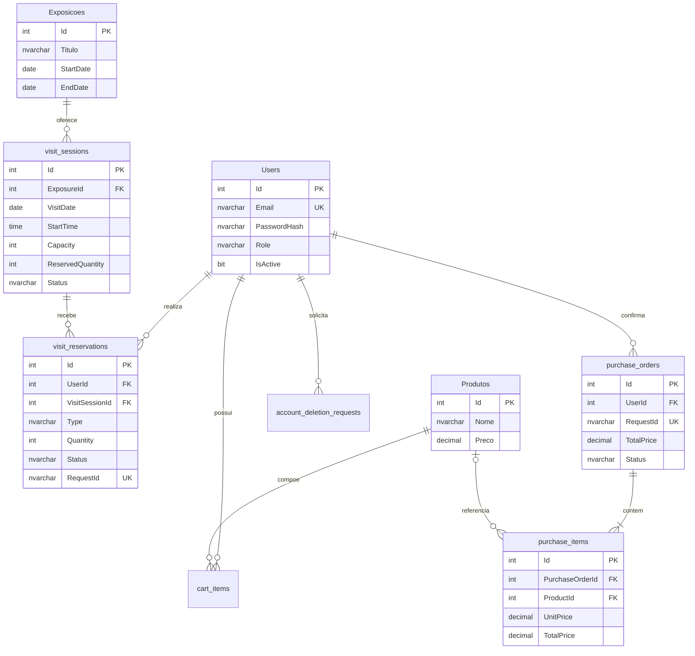

# Modelo de dados — PIM IV

## Modelo entidade-relacionamento

## Modelo lógico

`Users` concentra autenticação e perfil. Exposições possuem sessões; ingressos e agendamentos são tipos diferentes em `visit_reservations`, mas compartilham a capacidade da sessão. Pedidos e itens preservam nomes e valores confirmados, mesmo que o produto mude depois. Carrinho, idempotência, solicitações de exclusão, auditoria e históricos legados permanecem separados conforme sua finalidade.

As relações históricas usam exclusão restrita. Produtos podem ficar nulos somente nos itens históricos, que já guardam nome e preço. O carrinho é transitório e pode ser eliminado junto com a conta durante a anonimização.

## Modelo físico

- Chaves primárias: `int IDENTITY(1,1)`.
- Valores monetários: `decimal(18,2)`.
- Datas de exposição e sessão: `date`; horário local da sessão: `time(0)` no fuso de São Paulo.
- Instantes de criação, cancelamento e auditoria: `datetime2`, armazenados em UTC.
- E-mail possui índice único.
- Reservas possuem unicidade por usuário e chave da solicitação.
- Sessões possuem unicidade por exposição, data e horário.
- Restrições `CHECK` impedem preços ou quantidades inválidas e ocupação fora de `0..Capacity`.
- Chaves estrangeiras históricas usam `NO ACTION`; não há CPF no modelo.

As tabelas `data_import_history` e `data_migration_issues` registram a transferência e inconsistências legadas sem inventar relacionamentos. `admin_audit_logs` é reutilizada pela trigger de sessões.
